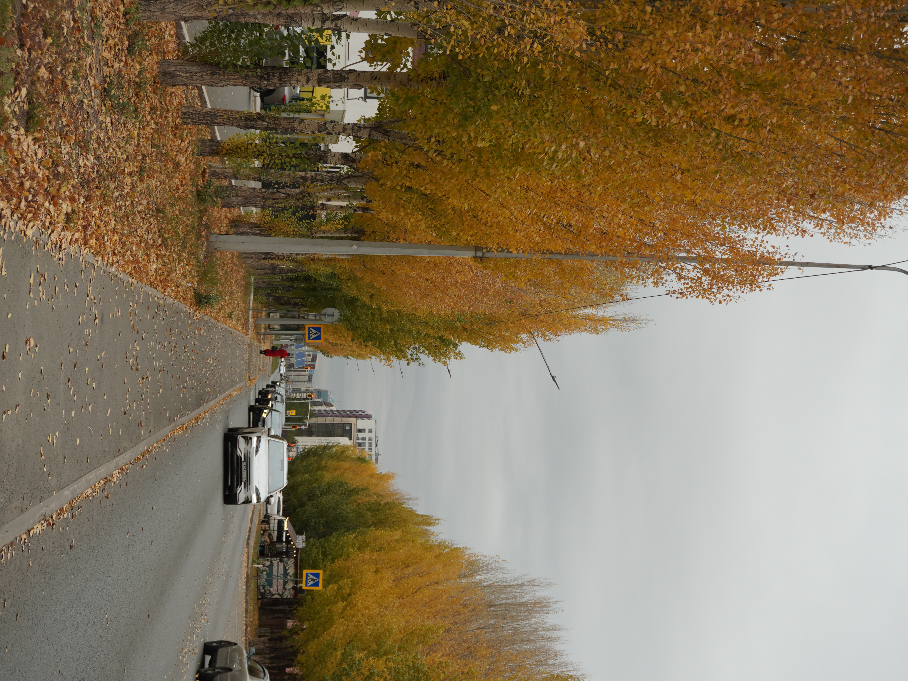

# Заголовок 1
## Заголовок 2
### Заголовок 3
#### Заголовок 4
##### Заголовок 5
###### Заголовок 6
Заголовок 7
-

1. пункт списка
     * пункт списка
    - пункт списка
    + пункт списка
    

***

Аю отыр **партады**,екі *қолы* ***қалтада***

`
$a = 5;
$b = 6;
$c = $a + $b;
`

>Цитата

[Текст](https://www.ieltsadvantage.com/2023/01/15/ielts-writing-task-2-sample-essays/)

Item      | Value | Quantity
----------|-------|---------
Computer  | 1600  | 3
Phone     | 12    | 2
Pipe      | 1     | 1